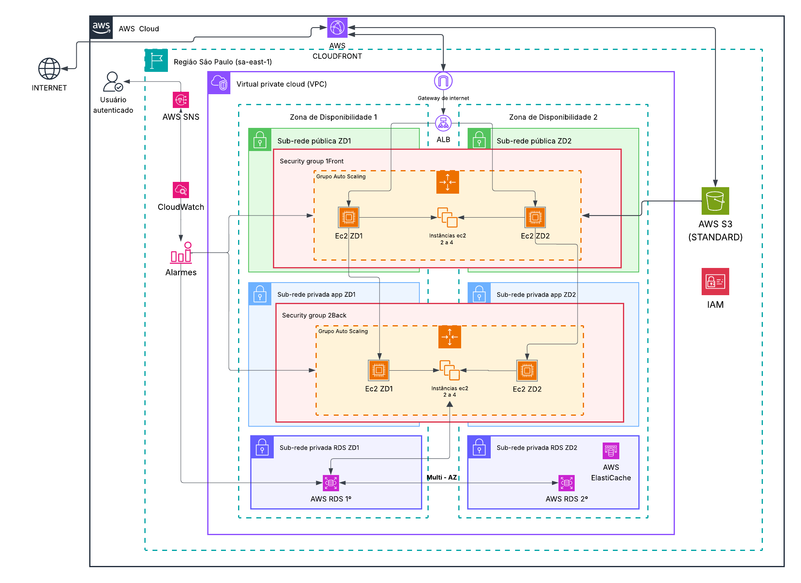
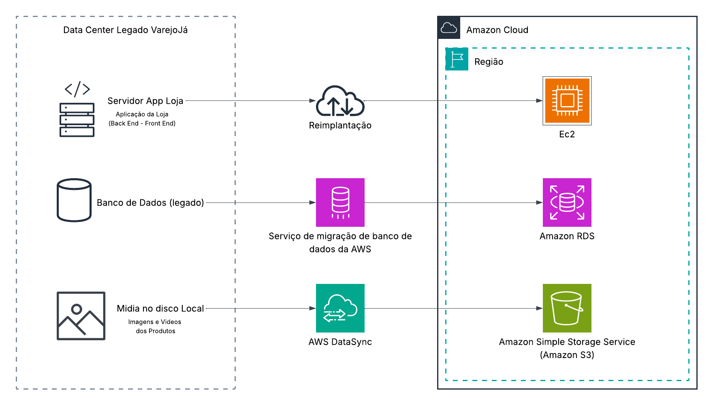

<div align="center">

# <p align="center">
 
</p>

### Modernização de Marketplace na AWS

Uma proposta escalável, segura e preparada para crescer.


</div>

## 📋 Sobre o projeto

A **VarejoJá** é um marketplace fictício do case de conclusão do AWS re/Start da Generation Brasil, que representa uma empresa de comércio eletrônico com uma infraestrutura tradicional, hospedada em um data center próprio. Nesse ambiente, a aplicação da loja, o banco de dados e as imagens e vídeos dos produtos dependem de recursos locais para funcionar. 

O presente projeto propõe modernizar essa infraestrutura legada de data center para uma arquitetura AWS com foco em **alta disponibilidade, escalabilidade, segurança e observabilidade**, para lidar melhor com momentos de alta demanda.

Pois embora a estrutura legada atenda à operação cotidiana, ela apresenta limitações quando a demanda aumenta, especialmente em períodos sazonais como a Black Friday e o Natal. Nessas situações, o crescimento do número de acessos pode sobrecarregar os servidores, comprometer o desempenho da plataforma e aumentar o risco de indisponibilidade. Além disso, o armazenamento local das mídias e a realização de backups mensais manuais dificultam a expansão da infraestrutura e a recuperação de informações em caso de falhas. 

Diante desse cenário, nosso desafio foi planejar essa modernização da infraestrutura utilizando serviços da AWS, buscando uma solução capaz de acompanhar as variações de demanda, aumentar a disponibilidade da aplicação e melhorar a proteção dos dados.

> [!NOTE]
> Esse repositório apresenta a proposta arquitetural documentada. A implementação prática e os testes de infraestrutura não fazem parte da entrega acadêmica, mas podem ser desenvolvidos futuramente em uma V2.

### 💥 Principais dores apresentadas no case

A partir das características da infraestrutura atual, identificamos os principais desafios e relacionamos cada um deles às soluções consideradas na arquitetura proposta.

| Desafio | Efeito | Resposta arquitetural proposta |
|---|---|---|
| Picos sazonais | Lentidão e risco de indisponibilidade | Auto Scaling e balanceamento de carga |
| Componente centralizado | Ponto único de falha | Distribuição em duas zonas de disponibilidade e RDS Multi-AZ |
| Fotos e vídeos em disco local | Expansão e entrega de conteúdo menos flexíveis | S3 + CloudFront |
| Proteção dos dados | Recuperação mais difícil em caso de falha/exclusão | Backups do RDS, versionamento do S3 e procedimentos de restauração |
| Falta de visibilidade operacional | Detecção tardia de problemas | CloudWatch + alarmes + SNS |

### 🎯 Recorte do trabalho

O projeto foi dividido em duas perspectivas, diferenciando a proposta desenvolvida durante o programa das possibilidades de implementação prática futura

- **Proposta acadêmica:** elaboração do diagrama de arquitetura, seleção e análise dos serviços AWS, definição da estratégia de migração e estimativas de custos utilizando a AWS Pricing Calculator.
- **Evolução de portfólio (planejada):** implementação de templates CloudFormation, implantação controlada em laboratório, desenvolvimento de uma aplicação demonstrativa e realização de testes com documentação das evidências.

## 📖 Sumário

1. [Objetivos e requisitos](#-objetivos-e-requisitos)
2. [Arquitetura proposta](#-arquitetura-proposta)
3. [Serviços AWS e responsabilidades](#️-serviços-aws-e-responsabilidades)
4. [Como funciona o fluxo](#-como-funciona-o-fluxo)
5. [Estratégia de migração](#-estratégia-de-migração)
6. [Escalabilidade e datas sazonais](#-escalabilidade-e-datas-sazonais)
7. [Disponibilidade, segurança e riscos](#-disponibilidade-segurança-e-riscos)
8. [Custos e limitações das estimativas](#-custos-e-limitações-das-estimativas)
9. [Estrutura do repositório](#-estrutura-do-repositório)
10. [Equipe e responsabilidades](#-equipe-e-responsabilidades)
11. [Referências principais](#-referências-principais)


## ✅ Objetivos e requisitos

A partir dos desafios identificados no cenário atual da VarejoJá, definimos os principais objetivos da proposta.

**Objetivos:** elasticidade, separação de camadas, disponibilidade, proteção de dados, observabilidade e custos mais previsíveis.

Para orientar a construção da solução, estabelecemos os seguintes requisitos de arquitetura (ARQ) e seus respectivos critérios de verificação, que podem ser usados em uma futura implementação prática.

| ID | Requisito de arquitetura | Como será verificado |
|---|---|---|
| ARQ-01 | Rede distribuída em pelo menos duas AZs | Inspeção da configuração de sub-redes |
| ARQ-02 | Frontend e backend com escalabilidade independente | Dois Auto Scaling Groups e políticas identificáveis |
| ARQ-03 | Capacidade planejada: mínimo agregado de 4 e máximo de 8 EC2 | Configuração de min/desired/max por ASG |
| ARQ-04 | Banco relacional com estratégia Multi-AZ | Configuração de implantação e teste controlado de failover |
| ARQ-05 | Armazenamento de mídias em S3 | Upload/consulta com permissões restritas |
| ARQ-06 | Conteúdo estático distribuído pelo CloudFront | Inspeção da distribuição e testes HTTPS |
| ARQ-07 | Alarmes para condições operacionais | Evidência de evento de teste recebido pelo SNS |
| ARQ-08 | Plano de recuperação documentado | RTO/RPO propostos, simulação e registro de resultados |

## 📐 Arquitetura proposta

Com base nos objetivos e requisitos definidos, desenvolvemos uma arquitetura AWS que busca atender às necessidades da VarejoJá, combinando serviços de computação, armazenamento, rede e monitoramento.

A solução foi planejada para a região de São Paulo (sa-east-1), com recursos distribuídos entre duas Zonas de Disponibilidade (AZs), conforme apresentado no diagrama abaixo.

<p align="center">

</p>

A arquitetura está organizada em três camadas principais:

1. **Apresentação (frontend):** instâncias EC2 distribuídas entre duas sub-redes públicas, controladas por um grupo de Auto Scaling próprio.
2. **Aplicação (backend):** instâncias EC2 em sub-redes privadas, gerenciadas por outro Auto Scaling Group.
3. **Dados:** Amazon RDS for MySQL Multi-AZ, com ElastiCache como componente de cache, além de Amazon S3 para mídias.

> [!NOTE] 
> O ALB distribui tráfego entre destinos, enquanto o CloudFront auxilia na entrega de conteúdo.

## 🛠️ Serviços AWS e responsabilidades

Para compor a arquitetura proposta, selecionamos serviços AWS com responsabilidades específicas, considerando os requisitos de escalabilidade, disponibilidade, segurança e armazenamento da VarejoJá.

A tabela abaixo apresenta os principais serviços e suas funções na solução.

| Categoria | Serviço | Papel na solução | Escopo |
|---|---|---|---|
| Rede | Amazon VPC, subnets, route tables e Internet Gateway | Isolamento e roteamento da rede | Proposto |
| Controle de acesso | Security Groups + AWS IAM | Restringir tráfego e permissões | Proposto |
| Computação | Amazon EC2 | Hospedar frontend e backend | Proposto |
| Elasticidade | EC2 Auto Scaling | Ajustar instâncias por camada | Proposto |
| Balanceamento | Application Load Balancer | Distribuir requisições | Proposto |
| Banco | Amazon RDS for MySQL Multi-AZ | Persistência relacional e disponibilidade | Proposto |
| Cache | Amazon ElastiCache | Reduzir consultas repetidas ao banco | Proposto |
| Objetos | Amazon S3 | Armazenar imagens e vídeos | Proposto |
| CDN | Amazon CloudFront | Entregar mídia e outros ativos estáticos | Proposto |
| Observabilidade | Amazon CloudWatch | Métricas, logs e alarmes | Proposto |
| Alertas | Amazon SNS | Notificar equipe | Proposto |
| Migração de banco | AWS DMS | Replicar/migrar banco legado | Fase de migração |
| Migração de arquivos | AWS DataSync | Transferir mídias locais para S3 | Fase de migração |

## 🔄 Como funciona o fluxo

E já com os serviços definidos, podemos entender como eles se relacionam durante o funcionamento do marketplace. O fluxo a seguir descreve o caminho das requisições, desde o acesso do cliente até o processamento e armazenamento dos dados.

1. O usuário acessa o marketplace via HTTPS.
2. O CloudFront pode responder a pedidos de conteúdo estático a partir do cache ou obter objetos do S3.
3. As requisições de aplicação chegam ao ALB, que as encaminha para destinos saudáveis conforme suas regras.
4. Frontend e backend usam grupos de escalabilidade independentes, distribuídos em duas AZs.
5. O backend consulta o ElastiCache para dados adequados a cache e usa o RDS MySQL para persistência.
6. Métricas e logs selecionados alimentam alarmes no CloudWatch; notificações podem ser enviadas via SNS.

## 🚚 Estratégia de migração

Além de definir a arquitetura AWS, planejamos uma estratégia para migrar a infraestrutura atual da VarejoJá para a nuvem com segurança, buscando preservar os dados e reduzir os impactos na operação da loja.

Para isso, dividimos a migração em três frentes principais, considerando os componentes existentes no data center e seus respectivos destinos na AWS.

| Frente | Origem | Destino | Estratégia |
|---|---|---|---|
| Aplicação | Servidores do data center legado | EC2 frontend/backend | Reimplantação e configuração das dependências |
| Banco relacional | Banco legado | RDS MySQL | AWS DMS, validação e corte planejado |
| Mídias | Arquivos locais | Amazon S3 | AWS DataSync e conferência de objetos |

O diagrama abaixo apresenta uma visão geral dessa transição, desde a infraestrutura atual até os serviços AWS propostos.

<p align="center">

</p>

A estratégia também considera a consistência dos dados, os testes de rollback e a definição de uma janela de corte, buscando realizar a transição com o menor impacto possível para a operação do marketplace. Para mais detalhes sobre o planejamento, consulte a documentação da estratégia de migração: [docs/migration.md](docs/migration.md).

## 📈 Escalabilidade e datas sazonais

Um dos principais desafios da VarejoJá é lidar com o aumento de acessos em períodos sazonais, como a Black Friday e o Natal. Para atender a essas variações de demanda, propomos o uso de dois Auto Scaling Groups independentes, permitindo ajustar a capacidade do frontend e do backend conforme a necessidade.

A arquitetura prevê um total de 4 instâncias EC2 no mínimo e 8 no máximo, distribuídas entre duas Zonas de Disponibilidade:

| Camada | Capacidade mínima | Capacidade máxima | Distribuição desejada |
|---|---:|---:|---|
| Frontend | 2 | 4 | Pelo menos uma instância por AZ em condições normais |
| Backend | 2 | 4 | Pelo menos uma instância por AZ em condições normais |
| **Total** | **4** | **8** | **Duas AZs** |

A apresentação trabalha com **2.000 acessos simultâneos em um dia comum** e **10 mil a 12 mil em datas de pico**. Esses números são **premissas ilustrativas** que estimamos com base em uma empresa de médio porte, não carga medida. A relação "uma instância atende aproximadamente 1.000 acessos" não prova que 8 instâncias suportem o pico: o dimensionamento dependerá de carga, latência, banco de dados, cache, padrões de sessão e testes.

> [!TIP] 
> **Simulação de período sazonal:** para representar uma semana de maior demanda (168 horas), consideramos a possibilidade de expansão temporária da capacidade, seguida de redução automática quando o tráfego diminuir. As políticas de escalabilidade e a capacidade efetivamente necessária dependerão de testes de carga.

## 🔐 Disponibilidade, segurança e riscos

Além de suportar variações de demanda, a arquitetura precisa considerar possíveis falhas e a proteção das informações do marketplace. Para isso, propomos medidas de disponibilidade, segurança e recuperação, respeitando as limitações de uma solução ainda não implementada.

### Disponibilidade não é recuperação de desastres

- **Multi-AZ** mitiga determinadas falhas de infraestrutura/zona dentro da região.
- **Backups e versionamento** ajudam na recuperação de dados, mas exigem testes e política de retenção.
- **DR regional** depende de estratégia própria, metas de RTO/RPO, cópias/replicação adequadas e exercícios documentados; não está implementado no case.

### Medidas propostas

- Aplicar **menor privilégio** em roles IAM e credenciais temporárias quando possível.
- Expor somente serviços e portas estritamente necessários.
- Manter banco e backend em sub-redes privadas.
- Preferir acesso administrativo sem SSH público, com SSM Session Manager e endpoints apropriados, quando disponível.
- Criptografar volumes/dados em repouso, exigir TLS em trânsito e bloquear acesso público ao bucket de mídias privadas.
- Servir conteúdo S3 pelo CloudFront com controle de acesso à origem, se essa for a topologia escolhida.
- Fazer rotação de segredos e evitar credenciais em código/README.

## 💰 Custos e limitações das estimativas

Para avaliar o custo estimado da arquitetura proposta, utilizamos a AWS Pricing Calculator, considerando a região de São Paulo (sa-east-1) e dois cenários de operação: demanda normal e período de pico. A tabela abaixo apresenta os valores utilizados na apresentação final do projeto.

| Serviço | Cenário normal (US$/mês) | Pico exibido (US$/mês) | Tipo de número |
|---|---:|---:|---|
| EC2 (frontend) | 2.117,68 | 2.605,04 | Normal cotado; pico simulado |
| EC2 (backend) | 2.117,68 | 2.605,04 | Normal cotado; pico simulado |
| RDS MySQL Multi-AZ | 428,41 | 428,41 | Estimativa |
| CloudFront | 216,45 | 216,45 | Estimativa mantida |
| S3 Standard | 41,13 | 41,13 | Estimativa |
| **Total** | **4.921,35** | **5.896,07** |

O slide de apresentação final exclui da soma principal **ALB, ElastiCache, CloudWatch e SNS**, embora esses serviços façam parte da arquitetura, pois são custos variáveis que o case não traz dados o suficiente para uma estimativa. Portanto, os valores acima **não representam TCO completo**. Também não representam projeção de preço contratual, impostos, transferência de dados entre AZs, endpoints, endereços IPv4 públicos, logs detalhados, suporte ou descontos efetivos. Para consultar as premissas e os detalhes das estimativas, acesse a documentação de custos: [docs/costs.md](docs/costs.md)

> [!NOTE]
> O custo de migração é **pontual**, separado da operação mensal.

## 📂 Estrutura do repositório

```text
varejoja-aws-architecture/
├── README.md
├── docs/
│   ├── VarejoJa_Apresentacao_Final.pdf 
│   ├── Case_TCC_awsrestart.pdf            
│   ├── architecture.md     # Planejado
│   ├── migration.md
│   ├── costs.md
│   ├── security.md         # Planejado
│   └── evolution.md        # Planejado
├── assets/
│   ├── diagrama_infraestrutura_geral.png          
│   ├── diagrama_migração.png           
│   ├── migration-aws-pricing-calculator.png
│   ├── logo-varejoja.png              
│   └── architecture-aws-pricing-calculator.png
```

## 👥 Equipe e responsabilidades

| Integrante | Papel na proposta final |
|---|---|
| Ingrid | Liderança ágil |
| Jamilly | Estratégia de migração |
| Guilherme | Jornada e documentação |
| Bruno | Seleção de serviços AWS |
| Paulo | Diagrama de arquitetura |
| Erick | Capacidade e escala |
| Marjorie | Estimativa de custos |

> [!IMPORTANT]
> Atribuições refletem a **apresentação final**, não necessariamente horas ou tarefas executadas tendo em vista que se trata de um projeto colaborativo. 
> Link da equipe: [VarejoJá no Linktree](https://linktr.ee/varejoja.awsrestart).

## 📚 Referências principais

- [AWS Well-Architected Framework](https://docs.aws.amazon.com/wellarchitected/latest/framework/welcome.html)
- [AWS CloudFormation - documentação](https://docs.aws.amazon.com/cloudformation/)
- [Amazon EC2 Auto Scaling](https://docs.aws.amazon.com/autoscaling/ec2/userguide/what-is-amazon-ec2-auto-scaling.html)
- [Amazon RDS Multi-AZ](https://docs.aws.amazon.com/AmazonRDS/latest/UserGuide/Concepts.MultiAZ.html)
- [AWS Database Migration Service](https://docs.aws.amazon.com/dms/)
- [AWS DataSync](https://docs.aws.amazon.com/datasync/)
- [AWS Pricing Calculator](https://calculator.aws/)
- [AWS Disaster Recovery](https://docs.aws.amazon.com/whitepapers/latest/disaster-recovery-workloads-on-aws/disaster-recovery-workloads-on-aws.html)
