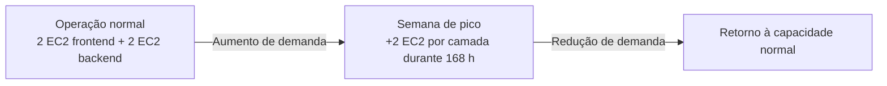
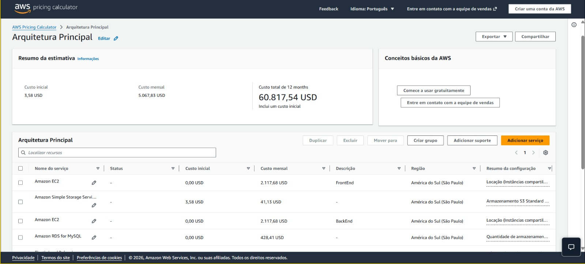
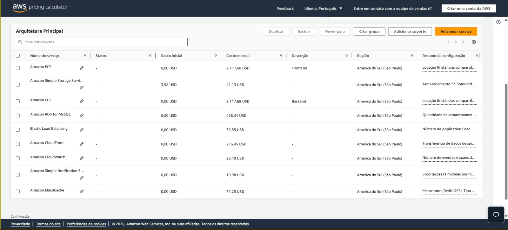
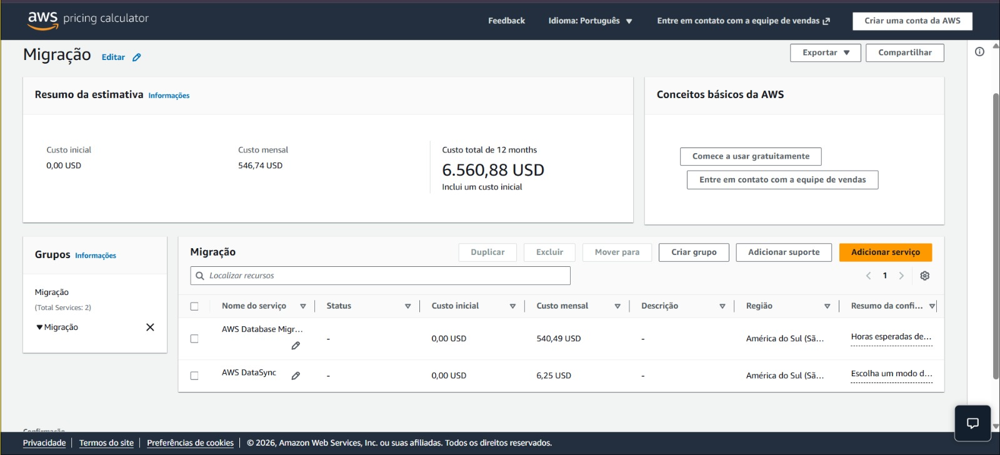

<div align="center">

<h1>💰 Estimativa de custos da VarejoJá</h1>

<p>Operação normal, picos sazonais e serviços de migração</p>


[← Voltar ao README](../README.md) · [Estratégia de migração](migration.md)

</div>

---

> [!IMPORTANT]
> **Esse documento apresenta estimativas acadêmicas, não custos reais de uma infraestrutura implantada.** O grupo definiu um recorte financeiro para a apresentação final. Alguns serviços presentes na arquitetura foram simulados na AWS Pricing Calculator, mas **não foram incluídos na soma principal**, devido à falta de dados fornecidos no case de estudo.

## 📖 Sumário

1. [Objetivo e escopo](#-objetivo-e-escopo)
2. [Resumo dos custos](#-resumo-dos-custos)
3. [Arquitetura: cenário normal e pico](#️-arquitetura-cenário-normal-e-pico)
4. [Serviços fora da soma principal](#-serviços-fora-da-soma-principal)
5. [Evidências da AWS Pricing Calculator](#-evidências-da-aws-pricing-calculator)
6. [Custos da migração](#-custos-da-migração)
7. [Premissas e limitações](#-premissas-e-limitações)
8. [Referências](#-referências)

## 🎯 Objetivo e escopo

Além de propor uma arquitetura escalável e disponível, o projeto VarejoJá considera o **impacto financeiro da modernização do marketplace**. Para apoiar essa análise, utilizamos a **AWS Pricing Calculator**, com serviços estimados na região de **São Paulo (`sa-east-1`)**, e construímos cenários de operação normal e de aumento temporário da demanda.

A apresentação final priorizou os componentes com premissas de custo definidas para o case: **EC2 (frontend e backend), RDS MySQL Multi-AZ, CloudFront e S3 Standard**. Outros serviços essenciais à arquitetura são descritos separadamente, sem serem tratados como gratuitos.

## 📊 Resumo dos custos

Os números abaixo correspondem ao **recorte utilizado na apresentação final**, e não ao custo total da solução AWS.

| Cenário | Valor estimado | Interpretação |
|---|---:|---|
| **Operação normal** | **US$ 4.921,35/mês** | Soma dos cinco componentes considerados na apresentação |
| **Mês com pico sazonal** | **≈ US$ 5.896,07/mês** | Simulação de expansão temporária das instâncias EC2 |
| **Diferença entre os cenários** | **≈ US$ 974,72** | Aumento estimado no mês com pico (aproximadamente 19,8%) |

> [!NOTE]
> A estimativa de pico é **uma simulação condicional**, não uma nova cotação integral da AWS Pricing Calculator. Os valores de RDS, CloudFront e S3 foram mantidos constantes no exercício apresentado pelo grupo.

## 🏗️ Arquitetura: cenário normal e pico

Para representar a variação de demanda em datas como a Black Friday, o grupo comparou a operação regular com uma semana de maior utilização. A simulação considera **duas instâncias EC2 por camada durante o mês** e **duas instâncias adicionais por camada durante 168 horas** no período de pico, conforme as premissas da apresentação.

| Componente | Premissa apresentada | Normal (US$/mês) | Pico (US$/mês) |
|---|---|---:|---:|
| EC2 - frontend | 2 instâncias × 730 h; pico: +2 × 168 h | 2.117,68 | 2.605,04 |
| EC2 - backend | 2 instâncias × 730 h; pico: +2 × 168 h | 2.117,68 | 2.605,04 |
| RDS MySQL Multi-AZ | Configuração estimada para o banco e armazenamento | 428,41 | 428,41 |
| CloudFront | Estimativa de distribuição de conteúdo mantida | 216,45 | 216,45 |
| S3 Standard | Estimativa de armazenamento mantida | 41,13 | 41,13 |
| **Total estimado** | | **4.921,35** | **≈ 5.896,07** |

A variação do cenário de pico está concentrada nas instâncias EC2. A proposta utiliza **Auto Scaling Groups independentes** para frontend e backend, permitindo aumentar a capacidade durante a alta demanda e reduzi-la posteriormente.



> [!WARNING]
> Capacidade não comprovada: a simulação financeira não demonstra que as instâncias suportariam uma quantidade específica de acessos simultâneos. O dimensionamento precisaria ser validado por testes de carga, métricas de desempenho e comportamento da aplicação.

## 🧩 Serviços fora da soma principal

A arquitetura proposta também contempla **Application Load Balancer (ALB), Amazon ElastiCache, Amazon CloudWatch e Amazon SNS**. Esses serviços não foram incluídos nos totais oficiais do slide e do README, pois o case não fornece dados suficientemente detalhados sobre seu padrão de utilização.

| Serviço | Papel na arquitetura | Por que o custo depende de mais premissas |
|---|---|---|
| Application Load Balancer | Distribuir requisições | Volume de tráfego e consumo de capacidade do balanceador |
| Amazon ElastiCache | Acelerar consultas com cache | Dimensionamento e características de uso do cache |
| Amazon CloudWatch | Coletar métricas, logs e alarmes | Quantidade de métricas, volume de logs e alarmes |
| Amazon SNS | Enviar notificações | Volume e tipo de notificações enviadas |

A AWS Pricing Calculator permite criar **estimativas ilustrativas** desses serviços mesmo sem medições reais. Na simulação complementar registrada pela equipe, os quatro itens somam US$ 146,48/mês:

| Serviço | Valor simulado (US$/mês) |
|---|---:|
| ALB | 32,85 |
| ElastiCache | 71,25 |
| CloudWatch | 22,40 |
| SNS | 19,98 |
| **Total complementar** | **146,48** |

Esses valores ajudam a demonstrar que os serviços geram custos, mas **não integram o recorte financeiro da apresentação**. Portanto, não devem ser somados silenciosamente aos US$ 4.921,35 ou usados para substituir os totais oficiais do projeto.

## 🖼️ Evidências da AWS Pricing Calculator

As capturas abaixo documentam as configurações simuladas pela equipe. É importante distinguir **o que aparece na ferramenta** do **recorte selecionado para a apresentação final**.

### Arquitetura principal (visão geral)

A calculadora mostra **US$ 5.067,83/mês** e **US$ 3,58 de custo inicial**. O valor mensal é superior ao total normal apresentado no slide porque **inclui os quatro serviços complementares** descritos anteriormente.

<p align="center">
  
</p>

### Arquitetura principal - serviços detalhados

A segunda captura permite visualizar os componentes adicionais e seus valores, que foram mantidos como **evidência de simulação**, não como parte da soma principal.

<p align="center">
  
</p>

**Conciliação dos valores:**

```text
Recorte da apresentação (normal)             US$ 4.921,35/mês
Serviços complementares simulados            US$   146,48/mês
                                             ---------------
Total da simulação abrangente da calculadora US$ 5.067,83/mês
```

> [!TIP]
> **Por que guardar as duas estimativas?** O recorte da apresentação documenta nossa decisão, mas as capturas registram uma exploração mais ampla dos custos, até mesmo para aprendizagem, indo um pouco além do escopo exigido pelo projeto.

## 🚚 Custos da migração

A migração foi estimada separadamente da operação regular, pois envolve serviços utilizados durante a transição do data center para a AWS: **AWS Database Migration Service (DMS)**, para o banco de dados, e **AWS DataSync**, para as mídias dos produtos.

| Serviço | Finalidade | Valor mensal exibido na calculadora |
|---|---|---:|
| AWS DMS | Migração/replicação do banco legado para o RDS | US$ 540,49 |
| AWS DataSync | Transferência dos arquivos locais para o S3 | US$ 6,25 |
| **Total exibido** | | **US$ 546,74** |

<p align="center">
  
</p>

> [!IMPORTANT]
> **US$ 546,74 é o valor mensal exibido pela calculadora para a configuração simulada, não o custo final de uma migração pontual.** O valor efetivo dependerá da duração dos recursos, volume de dados, transferências e testes. A projeção automática de 12 meses (**US$ 6.560,88**) não deve ser interpretada como orçamento de uma migração planejada para ocorrer uma única vez.

Esses valores **não foram adicionados ao custo mensal normal da arquitetura**. As etapas técnicas, os cuidados com a integridade dos dados e o planejamento da transição estão descritos em [migration.md](migration.md).

## ⚠️ Premissas e limitações

As estimativas são úteis para comparar cenários, mas **não representam o custo total de propriedade (TCO)** nem substituem uma avaliação de consumo em produção.

- **Escopo parcial:** ALB, ElastiCache, CloudWatch e SNS estão previstos na arquitetura, mas fora dos totais da apresentação.
- **Pico sazonal simulado:** a expansão de EC2 por 168 horas é uma hipótese de planejamento; não foi validada por testes de carga.
- **Demais serviços constantes:** os valores de RDS, CloudFront e S3 foram mantidos iguais nos dois cenários da apresentação, embora possam variar na prática.
- **Custos adicionais:** rede, tráfego entre AZs, endereços IPv4 públicos, logs, endpoints, impostos, suporte e outros itens podem afetar a fatura.
- **Migração temporária:** DMS e DataSync possuem dinâmica de cobrança distinta da operação contínua e exigem definição de duração e volume.
- **Estimativa, não implantação:** a equipe não executou a arquitetura completa nem coletou métricas reais de utilização.

### Sobre a comparação com capacidade fixa

A apresentação também utiliza uma referência de **US$ 8.470,72** para o cenário hipotético de manter oito servidores ligados durante o mês inteiro. Esse valor é uma **simulação de comparação**, não uma economia comprovada. Para calcular uma economia percentual confiável, seria necessário comparar cenários com os mesmos componentes, período e premissas de consumo.

> [!NOTE]
> Os valores desse documento refletem as premissas da apresentação acadêmica e as evidências fornecidas. Qualquer evolução para uma implantação real exigirá revisar as estimativas na AWS Pricing Calculator e validar o dimensionamento.

## 📚 Referências

- [AWS Pricing Calculator](https://calculator.aws/)
- [Documentação da AWS Pricing Calculator](https://docs.aws.amazon.com/pricing-calculator/)
- [AWS Well-Architected - Cost Optimization Pillar](https://docs.aws.amazon.com/wellarchitected/latest/cost-optimization-pillar/welcome.html)
- [Estratégia de migração da VarejoJá](migration.md)
- [README do projeto](../README.md)

---

<div align="center">

**VarejoJá • AWS re/Start - Generation Brasil**

[← Voltar à visão geral do projeto](../README.md)

</div>