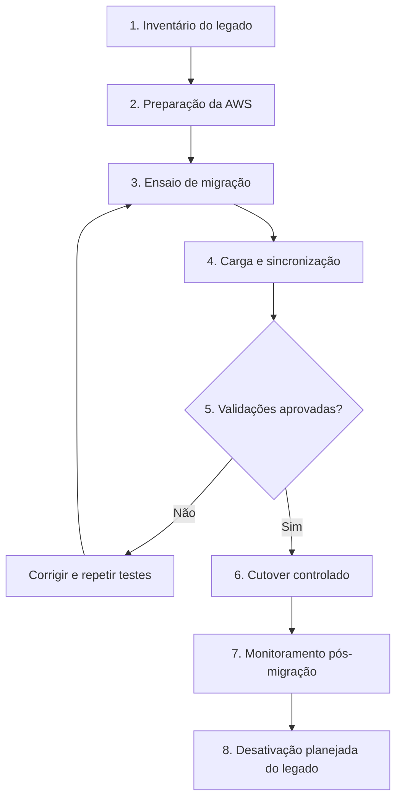

<h1>🚚 Estratégia de Migração para a AWS</h1>

Da infraestrutura local para a nuvem, com planejamento, validação e continuidade operacional.

[← Voltar ao README](../README.md)

> [!IMPORTANT]
> **Escopo acadêmico:** esse documento descreve uma **estratégia proposta**, não uma migração executada. A compatibilidade do ambiente legado, os tempos de execução, as configurações definitivas e os resultados dos testes precisam ser confirmados antes de qualquer implantação.

## 📖 Sumário

1. [Visão geral e objetivo](#-visão-geral-e-objetivo)
2. [Cenário atual e destino](#-cenário-atual-e-destino)
3. [Estratégia por componente](#-estratégia-por-componente)
4. [Etapas do plano de migração](#-etapas-do-plano-de-migração)
5. [Validação e critérios de aceite](#-validação-e-critérios-de-aceite)
6. [Cutover e plano de retorno](#-cutover-e-plano-de-retorno)
7. [Segurança e riscos](#-segurança-e-riscos)
8. [Custos e limitações](#-custos-e-limitações)
9. [Checklist de execução futura](#-checklist-de-execução-futura)
10. [Referências](#-referências)

---

## 🎯 Visão geral e objetivo

Como explicado, a VarejoJá utiliza, no cenário apresentado pelo case, uma infraestrutura tradicional em data center, onde a aplicação do marketplace, o banco relacional e as mídias dos produtos dependem de recursos locais. A proposta de modernização busca levar esses componentes à AWS de maneira planejada, reduzindo riscos de indisponibilidade da loja e preservando a integridade das informações.

O objetivo desaa estratégia é definir o caminho de transição entre o ambiente atual e a arquitetura de referência apresentada no [README](../README.md), com atenção especial à continuidade da loja durante a mudança para uma transição simples e prática.

**Princípios que orientam o plano:**

- **Preservação dos dados:** conferir registros, arquivos e permissões antes da entrada em produção.
- **Mudança controlada:** testar a solução antes de direcionar o tráfego real ao novo ambiente.
- **Reversibilidade:** definir critérios e responsabilidades para interromper a transição, se necessário.
- **Observabilidade:** acompanhar a aplicação e os serviços durante e após a migração.

## 🏢 Cenário atual e destino

A migração foi organizada em três frentes, correspondentes aos componentes principais do ambiente legado. O diagrama apresenta o mapeamento proposto entre origem, serviço de migração e destino.

  

| Componente atual | Destino na AWS | Abordagem planejada |
|---|---|---|
| Aplicação da loja | Amazon EC2 — frontend e backend | **Reimplantação** da aplicação, com revisão de configurações e dependências |
| Banco de dados relacional | Amazon RDS for MySQL | **Migração de dados** com AWS DMS, condicionada à compatibilidade da origem |
| Imagens e vídeos dos produtos | Amazon S3 | **Transferência de arquivos** com AWS DataSync, seguida de conferência |

> [!WARNING]
> **Migração não é só cópia, além de mover dados e arquivos, é necessário ajustar conexões da aplicação, permissões, caminhos de mídia, configurações de rede e monitoramento.

## 🧩 Estratégia por componente

Cada componente exige um procedimento diferente. Por isso, não utilizamos um único serviço para toda a migração.

### 1. Aplicação: data center → Amazon EC2

A proposta é **reimplantar o frontend e o backend** em instâncias Amazon EC2, mantendo a separação entre as camadas definida na arquitetura de destino. Não se pressupõe que as máquinas do data center serão copiadas integralmente.

| Antes da transição | No ambiente AWS |
|---|---|
| Identificar versão da aplicação, dependências e configurações | Preparar instâncias e configuração das camadas frontend/backend |
| Identificar variáveis, integrações e conexões com o banco | Atualizar conexões para o RDS e referências às mídias no S3/CloudFront |
| Registrar comportamento esperado da loja | Testar rotas, funcionalidades essenciais e logs |

> [!IMPORTANT]
> O uso de Auto Scaling requer que novas instâncias possam iniciar a aplicação de forma consistente. O mecanismo de inicialização e implantação deverá ser definido em uma implementação futura.

### 2. Banco relacional: origem legada → Amazon RDS

O **AWS Database Migration Service (AWS DMS)** foi escolhido para apoiar a movimentação dos dados do banco legado até o Amazon RDS for MySQL. Antes de configurá-lo, é necessário verificar o mecanismo e a versão do banco de origem, a compatibilidade com o destino e as condições de conectividade.

O plano considera uma **carga inicial** e, se houver suporte técnico e necessidade de reduzir a janela de indisponibilidade, a avaliação de replicação contínua de alterações (*CDC*). O AWS DMS não substitui por si só a preparação do esquema, o tratamento de incompatibilidades ou os testes de integridade.

**Verificações essenciais:**

- Compatibilidade de mecanismo, versão, tipos de dados e esquema.
- Conectividade segura entre origem, serviço de migração e RDS.
- Contagem de registros e conferência de dados críticos.
- Consistência das transações no momento da troca de ambiente.

### 3. Mídias: armazenamento local → Amazon S3

O **AWS DataSync** foi escolhido para transferir imagens e vídeos do armazenamento local para o Amazon S3. Após a transferência, a aplicação deverá utilizar os novos caminhos de acesso, com entrega de conteúdo por CloudFront conforme a arquitetura proposta.

A validação deve verificar **quantidade de arquivos, integridade, estrutura de caminhos e permissões de acesso**. A existência de um bucket S3 não garante, sozinha, que os links de imagens da aplicação continuarão funcionando.

> [!TIP]
> O AWS DataSync é um recurso da **fase de migração**. Já o S3 e o CloudFront fazem parte da **operação prevista para o ambiente de destino**.

## 🗺️ Etapas do plano de migração

Para reduzir o risco de uma mudança direta para produção, propomos uma sequência de preparação, testes e transição controlada.

> [!IMPORTANT]
> As etapas acima são planejadas para implementação futura fora do escopo do projeto final, e não atividades já concluídas.

| Etapa | Atividade principal | Resultado esperado |
|---|---|---|
| **1. Inventário** | Mapear aplicação, banco, mídias, dependências e integrações | Escopo e incompatibilidades identificados |
| **2. Preparação** | Planejar VPC, acessos, segurança, RDS, EC2 e S3 | Ambiente de destino apto para testes |
| **3. Ensaio** | Executar uma migração em ambiente controlado | Problemas conhecidos antes do corte |
| **4. Transferência** | Reimplantar aplicação, migrar dados e sincronizar arquivos | Componentes disponíveis na AWS |
| **5. Validação** | Conferir dados, mídias, aplicação e conectividade | Critérios de aceite atendidos |
| **6. Cutover** | Direcionar a operação para o novo ambiente | Transição autorizada e acompanhada |
| **7. Observação** | Acompanhar métricas, logs e erros | Estabilidade verificada |
| **8. Encerramento** | Desativar origem somente após aprovação | Legado retirado sem perda de recuperação |

## ✅ Validação e critérios de aceite

Uma migração só pode ser considerada bem-sucedida após confirmar que os componentes transferidos continuam atendendo às necessidades do marketplace. A tabela abaixo apresenta os critérios propostos, que devem receber valores mensuráveis durante o planejamento executivo.

| Frente | O que validar | Evidência esperada |
|---|---|---|
| Aplicação | Páginas e operações essenciais funcionando | Registro dos testes funcionais e de conectividade |
| Banco de dados | Integridade e consistência das informações | Comparação de registros e verificações de dados críticos |
| Mídias | Arquivos íntegros e acessíveis conforme a política definida | Conferência de objetos e testes de carregamento |
| Segurança | Acessos limitados aos componentes autorizados | Revisão de permissões e regras de rede |
| Operação | Ausência de erros críticos após a troca | Logs, métricas e alarmes acompanhados |

> [!IMPORTANT]
> RTO e RPO ainda precisariam ser definidos para implementação. A proposta não apresenta tempos de recuperação ou perda de dados garantidos. Essas metas dependem das necessidades do negócio, dos mecanismos escolhidos e de testes.

## 🔁 Cutover e plano de retorno

O *cutover* é o momento em que a operação deixa de utilizar o ambiente antigo e passa a utilizar o ambiente AWS. Essa etapa deve ocorrer somente após aprovação dos testes e definição de responsáveis pela decisão.

**Sequência sugerida:** confirmar a janela de mudança → realizar sincronização final e checagens → ajustar conexões e direcionamento de tráfego → executar testes rápidos → acompanhar indicadores.

| Se a transição ocorrer como previsto | Se houver falha crítica |
|---|---|
| Manter monitoramento reforçado e registrar evidências | Interromper a mudança e avaliar os critérios de retorno |
| Validar funcionamento da aplicação, banco e mídias | Executar o procedimento de retorno previamente testado, quando viável |
| Aprovar encerramento do ambiente legado somente após período de observação | Reconciliar dados gravados após o corte antes de qualquer retorno |

> [!WARNING] retornar ao ambiente antigo pode exigir reconciliação de dados caso a aplicação já tenha recebido novas transações na AWS. Portanto, *rollback* não deve ser tratado como simples troca de endereço ou DNS.

## 🔐 Segurança e riscos

A movimentação de dados entre ambientes exige cuidados específicos, principalmente porque a origem está fora da AWS e os componentes de destino possuem diferentes requisitos de acesso.

### Cuidados de segurança

- **IAM e menor privilégio:** conceder apenas as permissões necessárias para migração e operação.
- **Conectividade:** definir rotas e regras de Security Groups adequadas; evitar exposição desnecessária de serviços.
- **Criptografia:** planejar proteção de dados em trânsito e em repouso.
- **Credenciais:** armazenar segredos fora do código e dos arquivos de documentação.
- **Backups:** garantir pontos de recuperação adequados antes do cutover e testar restauração.

### Matriz resumida de riscos

| Risco | Possível impacto | Mitigação proposta |
|---|---|---|
| Incompatibilidade do banco legado | Falha ou atraso na migração | Avaliação prévia de versões, esquema e tipos de dados |
| Divergência de dados | Informações inconsistentes | Validações e sincronização final antes do corte |
| Links de mídias incorretos | Imagens e vídeos indisponíveis | Testar caminhos, permissões e entrega por CloudFront |
| Falha na reimplantação da aplicação | Interrupção de funcionalidades | Ensaio, testes e plano de retorno |
| Permissões excessivas | Exposição indevida de recursos | Revisão de IAM, S3 e regras de rede |

## 💰 Custos e limitações

A migração pode gerar **custos temporários adicionais** aos valores mensais da arquitetura de destino, como recursos utilizados pelo AWS DMS, tarefas do DataSync, transferência de dados e operação simultânea dos dois ambientes durante a transição. Mas importante pontuar que esses serviços são usados somente uma vez, por esse motivo estão em uma arquitetura e estratégia separada

Esses custos não estão quantificados nesse plano, pois dependem de informações que o case não detalha, como volume de dados, duração da migração, conectividade e quantidade de arquivos. Para os valores recorrentes estimados da solução, consulte [docs/costs.md](costs.md) e a seção de custos do [README](../README.md).

## ☑️ Checklist de execução futura

Essa lista funciona como referência para uma possível implementação prática. 

- Inventariar versões, dependências e volumes do ambiente legado.
- Validar compatibilidade entre banco de origem, AWS DMS e RDS MySQL.
- Definir conectividade, permissões e requisitos de segurança.
- Preparar ambiente AWS e estratégia de implantação da aplicação.
- Realizar ensaio de migração em ambiente de teste.
- Conferir registros do banco e arquivos transferidos.
- Testar funcionalidades essenciais e observabilidade.
- Definir janela de cutover, responsáveis e critérios de retorno.
- Aprovar a transição somente após validação documentada.
- Monitorar o ambiente e planejar a desativação segura do legado.

> [!IMPORTANT]
> Nenhum dos itens acima é declarado como concluído no escopo acadêmico do projeto final.

## 📚 Referências

- [AWS Database Migration Service - documentação](https://docs.aws.amazon.com/dms/)
- [AWS DataSync - documentação](https://docs.aws.amazon.com/datasync/)
- [Amazon RDS for MySQL - documentação](https://docs.aws.amazon.com/AmazonRDS/latest/UserGuide/CHAP_MySQL.html)
- [Amazon S3 - documentação](https://docs.aws.amazon.com/AmazonS3/latest/userguide/Welcome.html)
- [AWS Prescriptive Guidance - migração](https://docs.aws.amazon.com/prescriptive-guidance/)

---

**VarejoJá • AWS re/Start - Generation Brasil**

[← Voltar à visão geral do projeto](../README.md)

